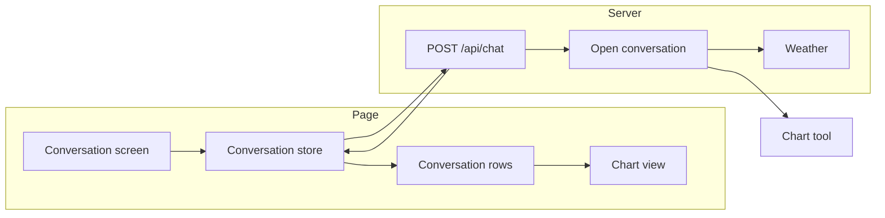
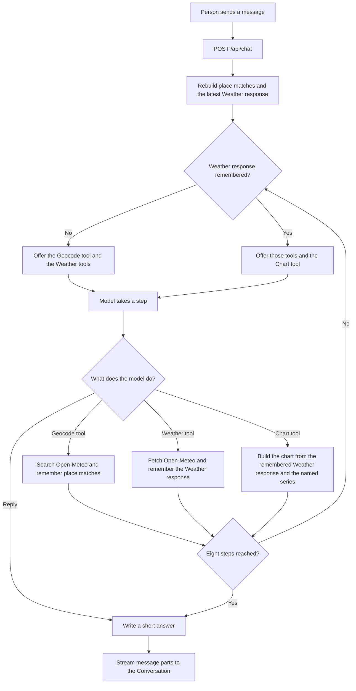
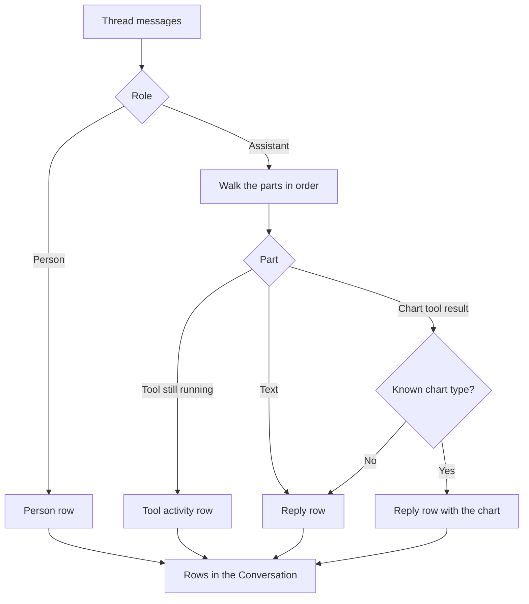

# Architecture flow

The product is split so the Conversation, the chat route, Weather, and the chart stay apart. A domain calls another through its public function or route.

`app/components/chat/` owns messages and parts. `app/stores/conversation.ts` keeps each Conversation and posts it to `/api/chat`. `server/api/chat.post.ts` is the route. `server/chat/` owns the model, the briefing, and the eight-step limit. `server/weather/` fetches Open-Meteo and maps a Weather response. `app/chart/` is the Chart tool. `app/components/chart/` draws a Chart tool result.

## Tool steps

On each model step, the Chart tool is offered only after a Weather response is remembered. The Geocode tool and the Weather tools stay available. Tool results are streamed back as parts, and the model continues until it replies or reaches eight steps.

A Weather tool call uses one Open-Meteo source: forecast, archive, historical forecast, previous runs, single runs, ensemble, marine, air quality, flood, climate, seasonal, or satellite radiation. Several places go in that one call. The Chart tool reads the remembered Weather response and the series the model named. It does not fetch Open-Meteo.

## What the Conversation shows

The page turns message parts into rows. A running tool is Tool activity and names the Geocode tool, a Weather tool, or the Chart tool. A finished Chart tool result that has a known chart type becomes the chart under the reply. Model reasoning stays off those rows. In development, the turn panel on the right lists the tools from the latest assistant message and can show the raw tool data and reasoning. The production build leaves that panel out.

