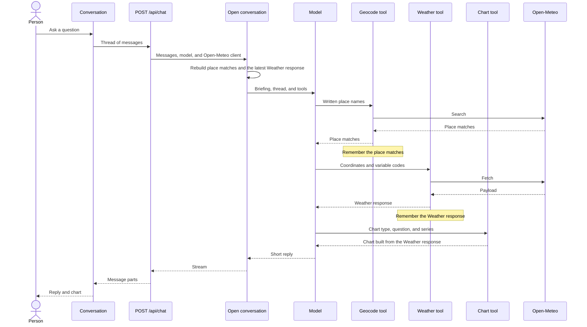

# Request sequence

A person asks a question in a Conversation. The page sends the thread to `POST /api/chat`. The model may call the Geocode tool, one Weather tool, and then the Chart tool. The page shows the reply and the chart in the same thread.

Each request rebuilds memory from earlier messages: place matches from the Geocode tool, and the latest Weather response. The Chart tool stays inactive until that Weather response exists. A request stops after eight model steps.

When the person names a place the model does not understand, the model asks which place they mean and stops. It does not call a Weather tool or the Chart tool on that step.
